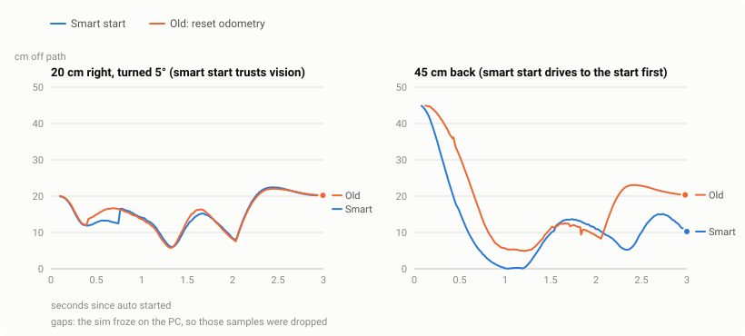
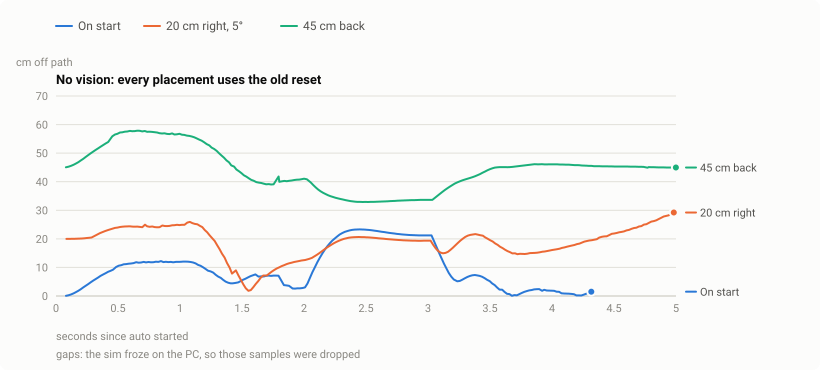

# 2026RobotCode

## To do:
 - hehe, nothing
## Scripted sim testing
Runs the robot in sim with a scripted "driver" (auto, then a teleop sequence of driving, intaking, x-lock, shooting and unsticking), saves a `.wpilog`, and checks it for problems.

```
./gradlew simulateJava -PscriptedSim    # ~50 s, headless, writes logs/akit_*.wpilog
./gradlew analyzeSimLog                 # report on the newest log in logs/
```

- The script lives in `src/main/java/frc/robot/utils/ScriptedSimDriver.java`; it only runs with `-PscriptedSim`, never on the real robot. The auto it runs is whatever the AutoChooser defaults to.
- The analyzer lives in `src/tools/java/SimLogAnalyzer.java` (not deployed to the robot). Thresholds are at the top of the file.
- `./gradlew analyzeSimLog -Plog=logs/some.wpilog` analyzes a specific log (works on real robot logs too, minus the checks that need the sim's true pose).
- `./gradlew analyzeSimLog -Plist` lists every logged key; `-Pdump=key1,key2 -Pfrom=5 -Pto=8 -Pevery=5` prints values loop by loop. In Git Bash, set `MSYS_NO_PATHCONV=1` first so keys starting with `/` aren't mangled.
- Every sim run (scripted or not) now also writes a `.wpilog` to `logs/`, so you can open it in AdvantageScope afterwards.
- If Gradle can't find Java, set `JAVA_HOME` to WPILib's JDK (`C:\Users\Public\wpilib\2026\jdk`).

## Camera calibration (no tape measure for the cameras)
`CalibrateCameras` works out each camera's `robotToCameraTransforms` entry from what the camera sees. The only things you measure are where the robot is relative to one AprilTag and the tag's height.

1. Put the robot in front of a tag, facing it (or turned, for a rear camera), and measure the distance from the tag's face to the robot's **center**.
2. On the dashboard, under `cameraCalibration`, fill in the tag ID, that distance, any sideways offset or turn, and the tag center height (0 = use the official field layout height).
3. Press **Calibrate Cameras** (works while disabled) and keep the robot still for 4 s.
4. Each camera that saw the tag prints a `new Transform3d(...)` line to the console. Paste it into `VisionConstants.robotToCameraTransforms`. Results are also logged under `outputs/cameraCalibration/`, including a `cameraPose` you can view in AdvantageScope's 3D field.
5. Cameras facing different ways need separate runs: re-place the robot so the other camera sees a tag.

The tag doesn't have to be on a real field; any tag printed and taped to a wall works if you enter its height. `./gradlew simulateJava -PscriptedSim=calibrate` checks the math in sim: it should print values within about 0.5 in and 0.5 deg of the current `VisionConstants`.

## Match log review
The robot saves a `.wpilog` for every boot/match to the USB stick in the roboRIO (`/U/logs`). Copy them to your laptop (pull the USB stick, or use AdvantageScope: File > Download Logs), then:

```
./gradlew analyzeLog -Plog=path/to/logs/folder     # one line per match, with its problems
./gradlew analyzeLog -Plog=path/to/one.wpilog      # full report for one match
```

For real-robot logs it splits each log into disabled / auto / teleop and checks: alerts (e.g. disconnected motors) and when they happened, loop overruns, brownouts and battery sag, CAN bus errors and bus-off events, driver station comms drops, motor temperatures, stalled mechanisms (lots of current but not moving, i.e. a jam), swerve module tracking, odometry vs. vision drift and bad vision snaps, shooter spin-up and pivot settle times. Thresholds are at the top of `src/tools/java/SimLogAnalyzer.java`.

## Auto start position helper
While disabled, the robot compares where vision says it is to where the selected Choreo auto starts (Choreo autos reset odometry to the path start, so a robot placed off runs the whole auto off).
- **LEDs:** green = in position (within 5 cm / 2 deg), yellow = close (30 cm / 10 deg), red = far, normal rainbow = can't tell (no vision, or the auto doesn't start from a fixed spot, like BackUpAndShoot).
- **Dashboard** (Autonomous tab): `autoStart/Status` says how to move the robot, in the robot's own directions, e.g. "Move 12 cm forward, 3 cm left, turn 4 deg left (CCW)". The target spot is drawn on the field as `autoStart`.
- The LEDs go back to normal as soon as the robot is enabled.
- `./gradlew simulateJava -PscriptedSim=autostart` checks it in sim.

## Smart auto start
At the start of every Choreo auto (`AutoGenerator.smartStart`, in place of `resetOdometry()`), the robot decides how to start based on vision:
- **vision has a fix, robot within 30 cm / 10 deg of the path start:** keep the vision pose and start the path right away; the path follower pulls the robot onto the path.
- **vision has a fix, robot 30 cm to 1.5 m off:** drive to the path start first (up to 2 s), then start the path.
- **no recent vision, or more than 1.5 m off** (vision is probably wrong, or the wrong auto is selected): reset odometry to the path start, like before.

The decision prints to the console and is logged as `outputs/autoStart/decision`. Turn it off with the **Enable Smart Auto Start** toggle (Autonomous tab). `./gradlew simulateJava -PscriptedSim=autooffset` then `./gradlew analyzeLog` runs it from several misplacements, with it on and off, and shows how far the robot was from the path in the AUTO PATH TRACKING section.

### Sim results
CenterFuelLeft, run in sim from different misplacements. "Off path" is the distance between where the robot really was and where the original Choreo path wanted it at that moment. (In these tests resetting odometry does not also teleport the sim robot, so the old behavior can't cheat.)

**With vision.** Smart start vs. the old behavior (always reset odometry to the path start):

<picture>
  <source media="(prefers-color-scheme: dark)" srcset="docs/smart-auto-start/with-vision-dark.svg">
  
</picture>

| Robot placed | Start method | Off path at 0.5 s | at 1 s | at 1.5 s |
|---|---|---|---|---|
| On start | trust vision | 7 cm | 8 cm | 12 cm |
| 10 cm back | trust vision | 7 cm | 7 cm | - |
| 20 cm right, 5 deg | trust vision | 13 cm | 14 cm | 12 cm |
| 20 cm right, 5 deg | old reset | 15 cm | 13 cm | 14 cm |
| 45 cm back | drive to start | 15 cm | **0 cm** | 10 cm |
| 45 cm back | old reset | **30 cm** | 5 cm | 12 cm |
| 2 m back | reset (too far to trust) | 180 cm | 141 cm | 98 cm |

- Small misplacements (yellow LEDs) make little difference either way: even after the old reset puts the robot in the wrong place, vision corrects the pose within about half a second and the follower fixes the rest.
- At 45 cm (red LEDs), driving to the start first gets the robot exactly onto the path, where the old reset is still 30 cm off half a second in, right where CenterFuelLeft enters the trench. It costs auto time: the path started 1.2 s late in a later run (the drive-to-start command waits until the robot is within 3 cm and stopped).
- Even from a perfect start the robot trails the path by 7 to 22 cm: the Choreo paths are planned with more motor torque (7.16 N·m) than the 60 A drive current limit allows.

**No vision** (camera unplugged, or no tags in view). The dashboard says "No vision, can't check position", the LEDs stay on the normal rainbow, and smart start falls back to the old reset every time:

<picture>
  <source media="(prefers-color-scheme: dark)" srcset="docs/smart-auto-start/no-vision-dark.svg">
  
</picture>

| Robot placed | Start method | Off path at 0.5 s | at 1 s | at 1.5 s | worst after 2 s |
|---|---|---|---|---|---|
| On start | reset (no vision) | 11 cm | 12 cm | 6 cm | 23 cm |
| 20 cm right, 5 deg | reset (no vision) | 24 cm | 25 cm | 4 cm | 29 cm |
| 45 cm back | reset (no vision) | 57 cm | 56 cm | 42 cm | 46 cm |

- Without vision nothing can tell the robot it was placed wrong, so the error just stays: 45 cm back is still about 45 cm off at the end. Placing the robot carefully is the only fix when the cameras can't see tags.
- The 20 cm right run gets back near the path around 1.5 s even without vision. That's probably the robot rubbing against the trench in the sim, not anything the code did.

To reproduce: `./gradlew simulateJava -PscriptedSim=autooffset`, `./gradlew analyzeLog -Pexport=docs/smart-auto-start/vision`, the same with `autonovision` / `no-vision`, then `python docs/smart-auto-start/make_charts.py`. Sim runs vary a little from run to run, and the sim sometimes freezes for a few hundred ms on the PC; the analyzer drops the 2 s after a freeze, which shows as gaps in the lines and as "-" in the tables.
